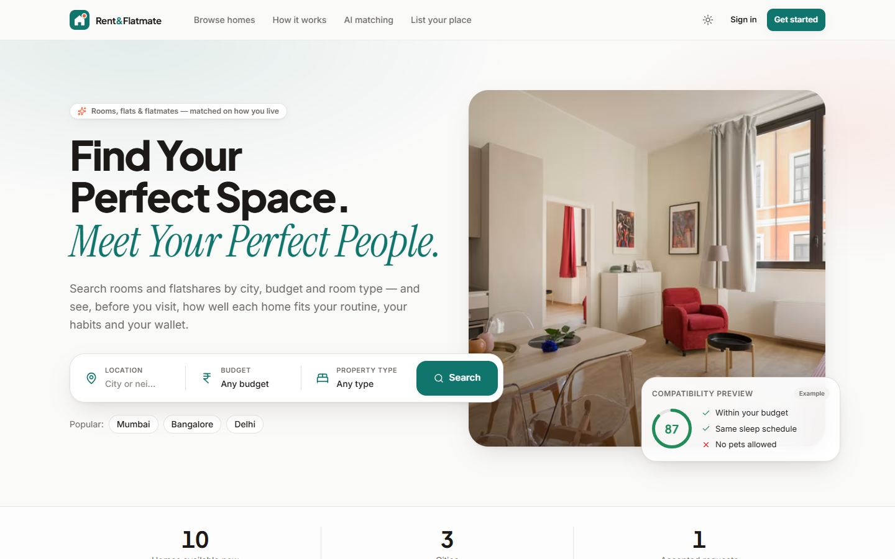
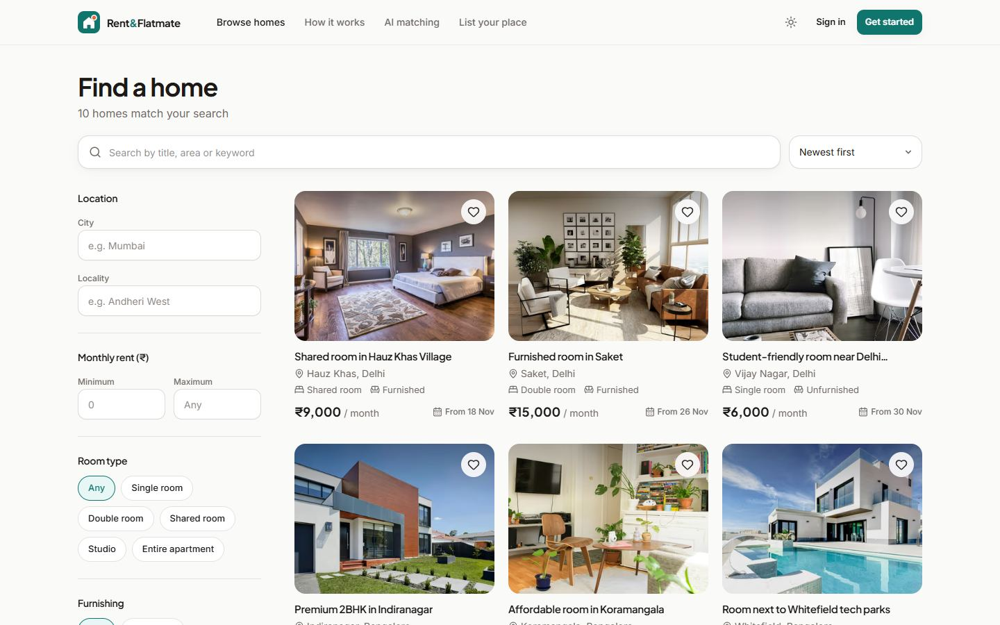
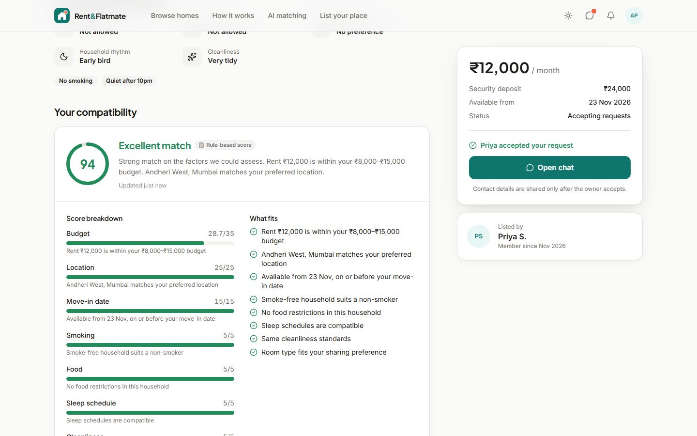
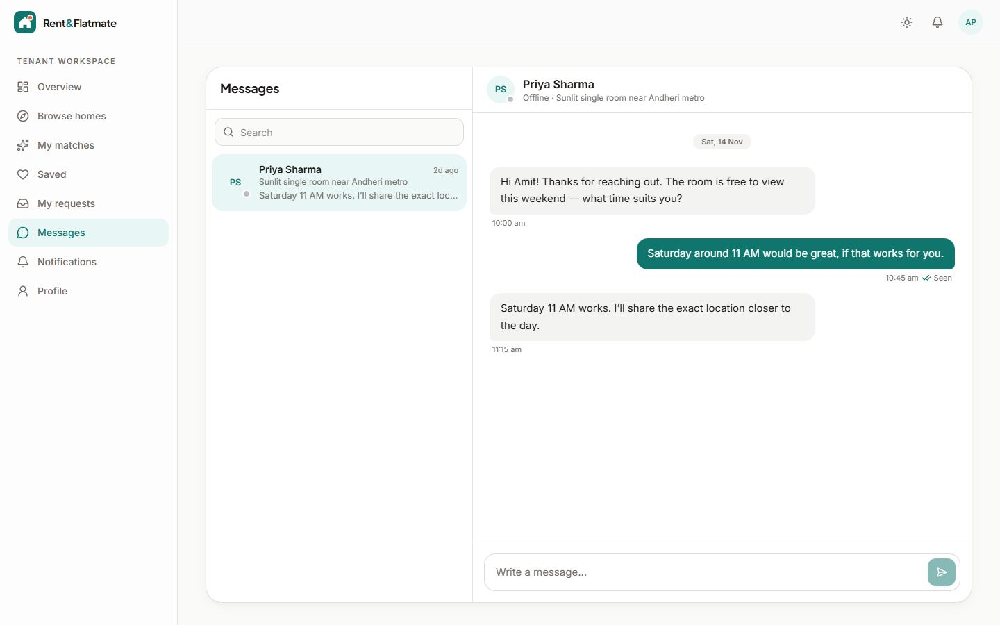
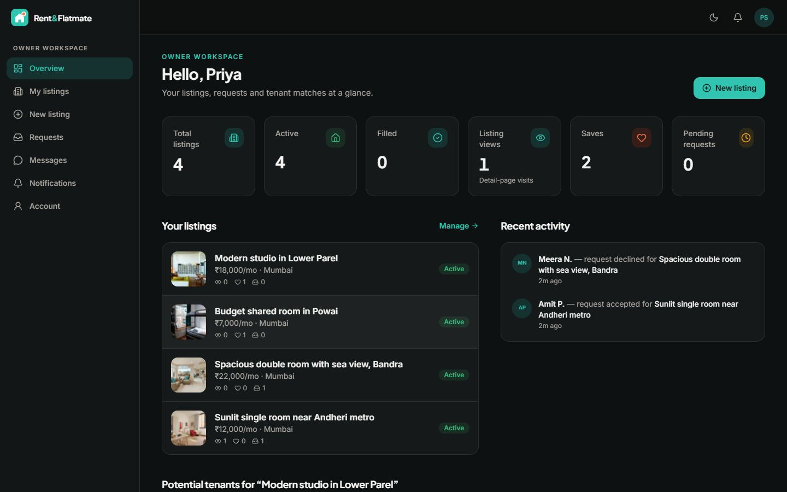
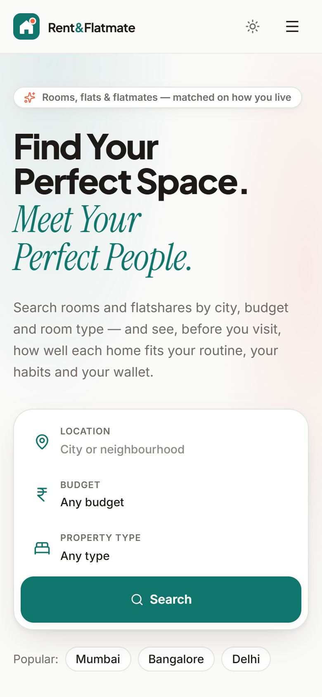

# Rent & Flatmate Finder

**Find your perfect space. Meet your perfect people.**

**Developed by Sachin Upadhyay**

A full-stack rental and flatmate discovery platform. Tenants search rooms and flatshares and see an
explainable **compatibility score** for every home, covering budget, location, move-in timing and lifestyle
fit, with an optional AI deep-dive. Owners publish listings, review requests, see which tenants fit
their household, and chat in real time once they accept.

> **Live demo:** not deployed yet. See [Deployment](#deployment) for the one-time setup.



---

## Contents

- [Screenshots](#screenshots)
- [Features](#features)
- [Tech stack](#tech-stack)
- [Architecture](#architecture)
- [Project structure](#project-structure)
- [Getting started](#getting-started)
- [Environment variables](#environment-variables)
- [Database](#database)
- [How compatibility matching works](#how-compatibility-matching-works)
- [API reference](#api-reference)
- [Testing & quality](#testing--quality)
- [Deployment](#deployment)
- [Security](#security)
- [Developer](#developer)
- [Credits](#credits)
- [License](#license)

---

## Screenshots

| Browse with filters | Explainable compatibility |
|---|---|
|  |  |
| **Real-time chat** | **Owner dashboard (dark mode)** |
|  |  |

<p align="center"></p>

Screenshots show the bundled **demo seed data**; the people and listings in them are fictional.

---

## Features

**Discovery**
- Search by keyword, city, locality, rent range, room type, furnishing, amenities, move-in date and
  flatmate gender preference (a filter only, never used in scoring)
- Sort by newest, rent, availability, or **best match** (ranked across all results, not just one page)
- URL-synced filters, debounced search, skeleton loading, empty/error states, mobile filter drawer
- Listing pages with a photo gallery + lightbox, household rules, amenities, and SEO metadata/JSON-LD
- Wishlist (saved homes) and recently viewed

**Matching**
- Instant, rule-based 0–100 score with a per-factor breakdown, strengths, conflicts and recommendations
- Optional **AI analysis** (OpenAI or Anthropic) on request, validated against a schema, cached, rate-limited,
  and clearly labelled; falls back to the rule-based result if the AI is unavailable
- Unanswered profile questions are excluded from scoring, never guessed
- Owners see rule-based **potential tenants** for their listings (names abbreviated, no contact details)

**Dashboards**
- *Tenant:* profile completion, recommended matches, saved homes, request tracking, conversations, notifications
- *Owner:* listing, view, save and request counts (all real database counts); listing management (create, edit,
  multi-photo upload and reorder, mark filled, delete with confirmation); request review with accept/decline
- *Admin:* platform stats, user activation, listing moderation

**Communication**
- Socket.IO chat: conversation list, unread counts, typing indicators, read receipts, online presence,
  optimistic send with retry, history pagination
- Notification centre with live push, unread badges and mark-as-read; transactional email via Resend

**Platform**
- Light/dark/system theme, responsive down to 360 px, keyboard and screen-reader friendly components
- httpOnly rotating refresh tokens, role-based access, rate limiting, strict input validation, security headers

---

## Tech stack

| Layer | Technology |
|---|---|
| Frontend | Next.js 16 (App Router, Turbopack), React 19, TypeScript, Tailwind CSS v4, Radix UI (shadcn-style components), lucide-react, sonner |
| Backend | Node.js 22, Express 4, TypeScript, Socket.IO 4, Zod, Pino, helmet, express-rate-limit, Multer |
| Data | PostgreSQL, Prisma ORM 6 |
| Integrations | Cloudinary (images, signed REST upload), Resend (email, HTTPS API), OpenAI / Anthropic (AI analysis) |
| Testing | Vitest + Supertest (backend), ESLint (type-aware + React compiler rules), Playwright for manual end-to-end checks |

---

## Architecture

```
Browser ──HTTPS──▶ Vercel · Next.js ── rewrites /api/*, /uploads/* ──▶ Render · Express API ──▶ Neon PostgreSQL
   │                                                                     │  Socket.IO          ├─▶ Cloudinary
   └───────────────────────── WSS (Socket.IO, bearer token) ─────────────┘                     ├─▶ Resend
                                                                                               └─▶ OpenAI / Anthropic
```

- The browser talks only to the Next.js origin for REST. The `/api` proxy keeps the **httpOnly refresh cookie
  first-party** and avoids CORS for REST calls.
- Socket.IO needs a persistent process, so the API runs on a long-lived host (Render/Railway/Fly), **not** as
  Vercel functions. The browser connects to it directly for WebSockets.

Details: [`docs/system-design.md`](docs/system-design.md) · [`docs/adr/002-compatibility-v2.md`](docs/adr/002-compatibility-v2.md)

---

## Project structure

```
├── backend/
│   ├── prisma/                 schema.prisma · migrations/ · seed.ts (demo data)
│   ├── src/
│   │   ├── app.ts              Express app (middleware, routes, error handler)
│   │   ├── index.ts            HTTP + Socket.IO server entry
│   │   ├── config/env.ts       validated environment
│   │   ├── lib/                jwt, prisma, socket, realtime, storage (Cloudinary/local), upload, logger
│   │   ├── middleware/         authenticate, requireRole, validate, rateLimiter, errorHandler
│   │   ├── routes/             auth, listings, profile, interests, saved, compatibility, chat,
│   │   │                       notifications, dashboard, stats, admin, health
│   │   ├── services/           compatibility, fallback-scorer, llm, token, chat, notification, email
│   │   └── validators/         Zod schemas
│   └── tests/                  Vitest unit + Supertest integration tests
├── frontend/
│   ├── public/images/          self-hosted hero imagery
│   └── src/
│       ├── app/
│       │   ├── (marketing)/    landing, /listings, /listings/[id]
│       │   ├── (auth)/         /login, /register
│       │   ├── (app)/          /dashboard/**, /messages/**, /notifications  (auth-guarded)
│       │   ├── (admin)/        /admin
│       │   └── sitemap.ts · robots.ts · not-found · error
│       ├── components/         ui/ (design system), listing/, chat/, layout/, notifications/, app/
│       ├── contexts/           auth, realtime (Socket.IO), theme
│       └── lib/                api client, types, formatting, hooks
├── docs/                       system design, deployment, schema, CI, ADRs, screenshots
├── render.yaml                 backend blueprint for Render
└── docker-compose.yml          local full stack (Postgres + API + web)
```

---

## Getting started

**Prerequisites:** Node.js ≥ 20.9 (22 recommended) and PostgreSQL ≥ 14 (or Docker).

### Option A: Docker

```bash
docker compose up --build
docker compose exec -e ALLOW_DEMO_SEED=true backend npx prisma db seed   # optional demo data
```

Open http://localhost:3000.

### Option B: run locally

```bash
# 1. Backend
cd backend
cp .env.example .env            # set DATABASE_URL and JWT_SECRET (see below)
npm install
npx prisma migrate deploy       # create tables
npm run db:seed                 # optional demo data (wipes the database!)
npm run dev                     # http://localhost:5000

# 2. Frontend (new terminal)
cd frontend
cp .env.example .env.local
npm install
npm run dev                     # http://localhost:3000
```

**Demo accounts** (after seeding; password `Password123!` or your `SEED_PASSWORD`):

| Role | Email |
|---|---|
| Tenant | `amit.patel@email.com`, `meera.nair@email.com`, `sneha.reddy@email.com`, `vikram.singh@email.com` |
| Owner | `priya.sharma@email.com`, `rajesh.kumar@email.com`, `anita.desai@email.com` |
| Admin | `admin@rentfinder.com` |

---

## Environment variables

Full, commented templates: [`backend/.env.example`](backend/.env.example) and [`frontend/.env.example`](frontend/.env.example).

**Backend**

| Variable | Required | Description |
|---|---|---|
| `DATABASE_URL` | ✅ | PostgreSQL connection string (Neon: use the direct, non-pooled URL) |
| `JWT_SECRET` | ✅ | ≥ 32 random characters, used to sign access tokens |
| `CORS_ORIGIN` | ✅ prod | Comma-separated frontend origins (REST + Socket.IO) |
| `APP_URL` | prod | Frontend URL used in email links |
| `TRUST_PROXY` | prod | Proxy hops in front of the API (`2` for Vercel → Render) |
| `LLM_PROVIDER`, `LLM_API_KEY`, `LLM_MODEL` | – | `openai` \| `anthropic` \| `none`; rule-based scoring when unset |
| `EMAIL_PROVIDER`, `EMAIL_API_KEY`, `EMAIL_FROM` | – | `resend` \| `nodemailer` \| `none` |
| `CLOUDINARY_CLOUD_NAME`, `CLOUDINARY_API_KEY`, `CLOUDINARY_API_SECRET` | prod | Image storage (local disk fallback in development) |
| `ACCESS_TOKEN_TTL`, `REFRESH_TOKEN_TTL_DAYS`, `COOKIE_SAMESITE`, `HIGH_SCORE_THRESHOLD`, `LLM_TIMEOUT_MS`, `PORT`, `LOG_LEVEL` | – | Tuning (sensible defaults) |

**Frontend**

| Variable | Required | Description |
|---|---|---|
| `BACKEND_URL` | ✅ | Express base URL; used by the `/api` + `/uploads` rewrites and SSR |
| `NEXT_PUBLIC_SOCKET_URL` | ✅ | Public API URL the browser uses for Socket.IO |
| `NEXT_PUBLIC_SITE_URL` | prod | Canonical site URL (metadata, sitemap) |

---

## Database

Prisma schema: [`backend/prisma/schema.prisma`](backend/prisma/schema.prisma) · reference: [`docs/schema.md`](docs/schema.md)

Core models: `User`, `TenantProfile`, `Listing`, `ListingPhoto`, `SavedListing`, `CompatibilityScore`,
`InterestRequest`, `Conversation`, `ChatMessage`, `Notification`, `RefreshToken`.

```bash
npx prisma migrate deploy   # apply migrations (production & CI)
npx prisma migrate dev      # create a new migration during development
npx prisma studio           # browse data
```

---

## How compatibility matching works

1. **Rule-based score (always, instant).** Each factor is scored only if *both* the tenant and the listing provided the data:

   | Factor | Max points |
   |---|---|
   | Budget fit (rent vs. tenant's min–max) | 35 |
   | Location (city or locality) | 25 |
   | Move-in timing | 15 |
   | Smoking · Pets · Food · Sleep schedule · Cleanliness · Room-type preference | 5 each |

   The score is normalised over the factors actually assessed, and missing ones are listed as "not assessed".
   Household policies fall back to free-text house rules (e.g. `no-pets`) when not set explicitly.
2. **AI analysis (on request).** The tenant clicks *Run AI analysis*. The listing and profile are sent as
   delimited, untrusted data; the model returns a score, summary, positives, conflicts and recommendations as
   schema-constrained JSON, which is validated with Zod. If the provider is not configured, times out, refuses
   or returns invalid output, the rule-based result is stored instead and labelled as such.
3. **Caching.** Results are stored per (tenant, listing) with a SHA-256 hash of every scored input. Any change
   to the profile or listing invalidates the score automatically. Browsing never triggers AI calls.

---

## API reference

All endpoints are under `/api`. Responses use `{ "status": "success", "data": … }` or
`{ "status": "error", "statusCode", "message", "errors?" }`. 🔒 = requires `Authorization: Bearer <access token>`.

| Method & path | Auth | Description |
|---|---|---|
| `POST /auth/register` · `POST /auth/login` | – | Create account / sign in → access token + httpOnly refresh cookie |
| `POST /auth/refresh` | cookie + `X-Requested-With: fetch` | Rotate refresh token, new access token |
| `POST /auth/logout` | cookie | Revoke the session |
| `GET /auth/me` · `PATCH /auth/me` · `POST /auth/change-password` | 🔒 | Account details |
| `GET /listings` | optional | Search: `q, city, locality, minRent, maxRent, roomType, furnishingStatus, genderPreference, amenities, availableBy, sort, page, limit, includeFilled` |
| `GET /listings/featured` · `GET /listings/cities` | – | Landing-page data |
| `GET /listings/:id` | optional | Listing + viewer data (saved, request status, compatibility) |
| `POST /listings/:id/view` | optional | Record a detail-page view |
| `GET /listings/mine` | 🔒 owner | Own listings with engagement counts |
| `POST /listings` · `PUT /listings/:id` | 🔒 owner | Create/update (multipart, `photos[]`, `photoOrder`) |
| `PATCH /listings/:id/status` · `DELETE /listings/:id` · `DELETE /listings/:id/photos/:photoId` | 🔒 owner | Manage |
| `GET /listings/:id/candidates` | 🔒 owner | Rule-based potential tenants |
| `GET /profile` · `POST /profile` | 🔒 tenant | Tenant preferences & lifestyle |
| `GET /compatibility/matches` · `GET /compatibility/:listingId` | 🔒 tenant | Ranked matches / cached score |
| `POST /compatibility/:listingId/analyze` | 🔒 tenant | AI analysis (rate-limited) |
| `GET /compatibility/status` | 🔒 tenant | Whether AI is configured |
| `POST /interests` · `GET /interests/mine` · `DELETE /interests/:id` | 🔒 tenant | Send / list / withdraw requests |
| `GET /interests/received` · `PATCH /interests/:id` | 🔒 owner | Review / accept / decline |
| `GET /saved` · `PUT /saved/:listingId` · `DELETE /saved/:listingId` | 🔒 | Wishlist |
| `GET /chat/conversations` · `GET /chat/unread-count` · `GET /chat/:id` · `GET /chat/:id/messages` · `POST /chat/:id/read` | 🔒 participant | Chat |
| `GET /notifications` · `GET /notifications/unread-count` · `PATCH /notifications/:id/read` · `PATCH /notifications/read-all` · `DELETE /notifications/:id` | 🔒 | Notifications |
| `GET /dashboard/tenant` · `GET /dashboard/owner` | 🔒 | Dashboard aggregates |
| `GET /stats/public` | – | Live platform counts |
| `GET /admin/stats` · `GET /admin/users` · `PATCH /admin/users/:id/toggle-active` · `GET /admin/listings` · `DELETE /admin/listings/:id` | 🔒 admin | Administration |
| `GET /health` | – | Liveness + DB connectivity |

**Socket.IO** (`auth: { token }`): client → `join:conversation`, `leave:conversation`, `message:send` (ack),
`typing:start|stop`, `messages:markRead`, `presence:query`; server → `message:new`, `chat:activity`,
`messages:read`, `typing:start|stop`, `presence:update`, `notification:new`.

---

## Testing & quality

```bash
cd backend
npm run lint && npm run typecheck
npm test            # needs DATABASE_URL pointing at a disposable test database
npm run build

cd ../frontend
npm run lint && npm run typecheck && npm run build
```

The backend suite (75 tests) covers the scorer, listing CRUD and filters, auth flows (rotation, reuse
detection, CSRF header, deactivation), upload content validation, mass-assignment protection, race-safe
interest handling, chat authorization, wishlist, notification scoping and security headers. CI runs all of it
against a real PostgreSQL with the real migration history: [`docs/ci.md`](docs/ci.md).

---

## Deployment

Frontend on **Vercel**; API + Socket.IO on **Render** (blueprint in `render.yaml`); **Neon** PostgreSQL;
**Cloudinary** images; **Resend** email. The step-by-step guide covers every environment variable (and where it
is configured) plus a post-deploy verification checklist: **[`docs/deployment.md`](docs/deployment.md)**.

---

## Security

Summary of controls (details in [`docs/system-design.md`](docs/system-design.md#6-security-controls)):
short-lived JWTs held in memory; rotating, revocable refresh tokens in httpOnly cookies with reuse detection;
bcrypt (cost 12) with timing-safe login; role and ownership checks on every mutation; Zod validation with
unknown-key stripping; magic-byte image validation; tiered rate limits; helmet + CSP + HSTS; HTML-escaped
emails; and no secrets in source (environment validated at boot).

---

## Developer

<table>
  <tr>
    <td>
      <strong>Sachin Upadhyay</strong><br />
      Full-stack developer, Rent &amp; Flatmate Finder
    </td>
  </tr>
</table>

### About the Developer

Sachin Upadhyay designed and built this version of Rent &amp; Flatmate Finder end to end:

- **Product &amp; UI:** the design system (light and dark themes), landing page, property discovery, tenant and
  owner dashboards, and the responsive mobile experience
- **Matching engine:** explainable rule-based compatibility scoring with AI analysis on demand, schema-validated
  output and content-hash caching
- **Real-time features:** Socket.IO chat with typing indicators, read receipts and presence, plus the notification centre
- **Security &amp; reliability:** rotating httpOnly refresh tokens, authorization checks, upload validation, rate limiting,
  race-safe transactions, and integration tests against a real PostgreSQL database
- **Deployment architecture:** Vercel frontend with a persistent Render API for WebSockets, Neon PostgreSQL and Cloudinary storage

---

## Credits

- **Developer:** Sachin Upadhyay
- **Original project:** Anumodit ([@anumodit740](https://github.com/anumodit740)), credited as the author of the
  original codebase on which this version builds
- **Photography:** listing and hero images from [Unsplash](https://unsplash.com) contributors, used under the Unsplash License
- **Open source:** built with Next.js, React, Tailwind CSS, Radix UI, lucide-react, Express, Socket.IO, Prisma, Zod and
  Pino, among others listed in each `package.json`

---

## License

Released under the **MIT License**, as declared in `package.json`.

<p align="center"><sub>Rent &amp; Flatmate Finder · Developed by <strong>Sachin Upadhyay</strong></sub></p>
